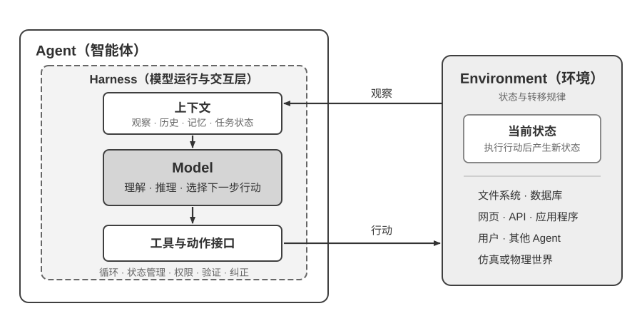
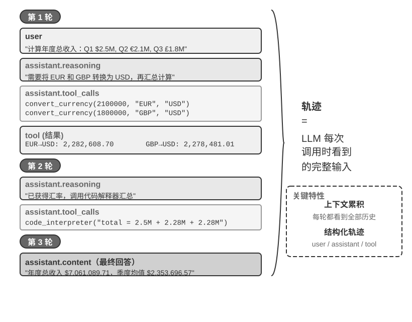
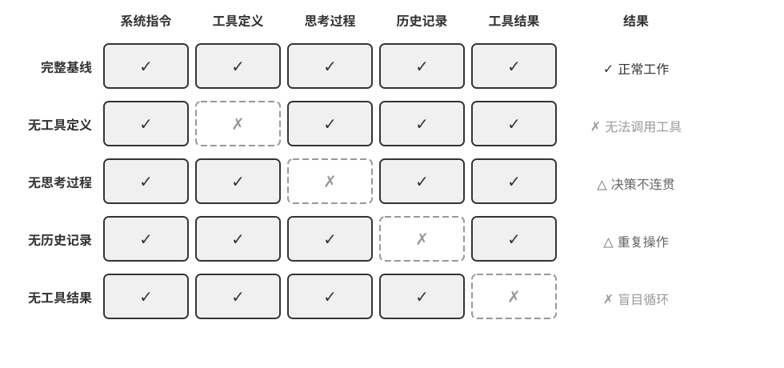
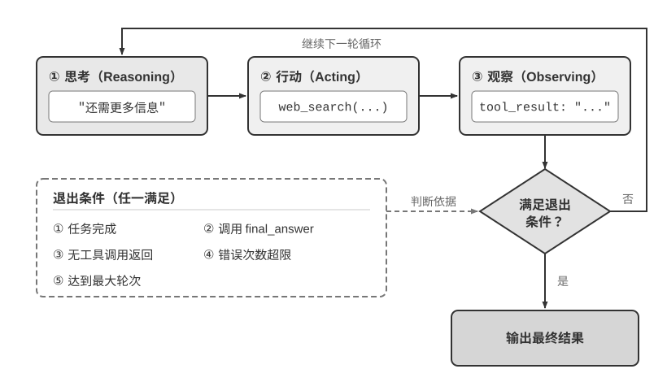
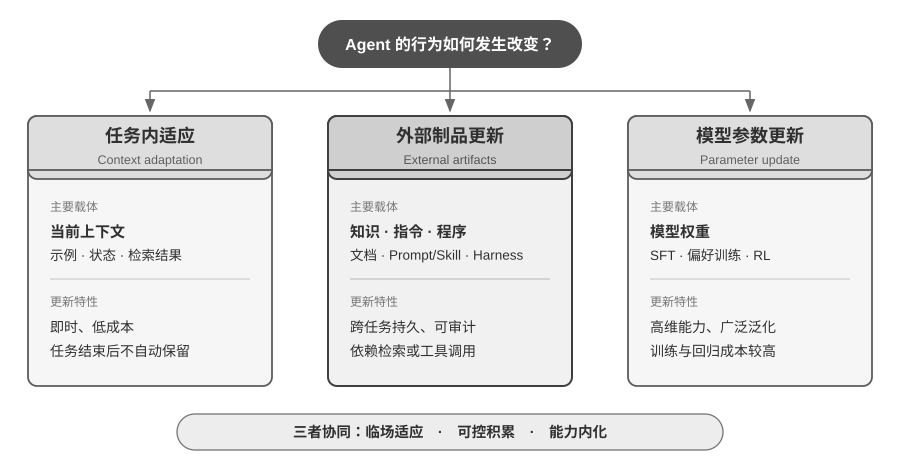

# Agent：组成、运行与工程架构

> 依据：李博杰《AI Agent 入门》第 1 章；Hello-Agents 第 1 章

## 一、核心组成与环境边界

Agent 是通过感知与行动与环境持续交互、朝向预设目标推进的自主系统。Agent 不等同于 LLM：传统决策可基于规则、世界模型或效用函数（Hello-Agents 架构），学习机制亦可叠加于其上。

现代 LLM Agent 具有两个互补的工程视角：

- **系统视角**：`Agent = LLM + 上下文 + 工具`。LLM 负责理解与决策，上下文提供即时决策依据，工具提供感知与行动接口。
- **架构视角**：`Agent = Model + Harness`。Harness 是 Agent 边界内、模型外部的运行与治理框架，负责上下文装配、工具调度、执行约束、状态验证与错误纠正。

### 核心辨析：环境 ≠ 上下文
- **环境**是 Agent 交互的外部实体（文件、网页、数据库、用户、物理世界）。
- **上下文**是 Harness 在特定决策步装配并递给模型的有限信息载体。环境中的信息只有被感知并提取进上下文，模型才“可见”。工具既是观察环境的传感器，也是改变环境的执行器。

---

## 二、运行机制：上下文装配、工具闭环与终止

### 上下文装配模型
典型消息式上下文由五部分构成：系统指令（System Prompt）、工具规范（Tool Definitions）、用户消息（User Messages）、历史模型回复（Assistant Replies）、工具执行结果（Tool Results）。

其结构规律为：  
$$\text{上下文} = \text{静态前缀} + \text{动态轨迹}$$

静态前缀（系统指令与工具定义）保持稳定；动态轨迹随交互单调增长。生产工程中会进一步引入分层检索、工具 Schema 按需延迟注入及长轨迹总结压缩机制。

*注：动态轨迹需结合静态前缀（系统指令与工具定义）方构成完整上下文。*

### 工具调用状态机
规范声明 $\to$ 模型生成调用请求 $\to$ Harness 拦截校验并真实执行 $\to$ 结果写回上下文 $\to$ 模型下一步决策。  
**核心原则**：模型输出工具请求不等于外部操作已完成；权限与执行控制必须由外部运行时保障。

### ReAct 范式与反馈闭环
将推理与行动交替组织：**思考（Thought） $\to$ 行动（Action） $\to$ 观察（Observation） $\to$ 再思考**。  
闭环的关键在于**环境反馈真实驱动后续推演**，而非单纯顺序调用工具。

### 上下文消融实验的工程启示

- **缺失工具定义**：模型丧失工具调度能力，但不会阻断，而是基于参数记忆生成伪合规回答（幻觉）。
- **缺失工具结果**：反馈回路断裂，Agent 陷入盲目重试直到耗尽资源。
- **缺失中间思考**：性能代价较小，推演动机往往可从前后观测中间接重构。
- **缺失交互历史**：重复劳动，重复犯同一个错。

**核心推论**：各组件工程价值非对称，取决于信息能否从其他链路代偿；**模型生成顺畅回答不代表任务成功执行**。

### 终止与中断机制

循环必须内置明确退出条件：达成目标、显式调用终结工具、模型判定无需行动、连续错误超限、步数/Token 预算耗尽。  
**人工干预（Human-in-the-loop）触发点**：遭遇高风险/不可逆操作、或连续自愈失败触发熔断时，平稳移交控制权。

---

## 三、能力演进的三个尺度

Agent 行为更新按时空尺度分为三层互补路径：

| 层次 | 更新载体 | 核心机制 | 生命周期与特性 |
| :--- | :--- | :--- | :--- |
| **任务内上下文适应** | 当前 Context | 示例、状态变量、检索片段 | 即时生效、极低成本；会话结束即销毁 |
| **跨任务外部产物更新** | 外部制品库 | 文档、Prompt、Skill、程序与 Harness | 跨任务持久化、显式可审计；依赖检索或调用激活 |
| **模型参数更新** | 模型权重 | 监督微调（SFT）、偏好学习、强化学习（RL） | 深度泛化、固化隐式策略；训练与部署成本高 |

三者协同分工：**上下文负责临场快速适应，外部产物负责确定性经验积累，权重更新负责高维能力内化。**

**“模型即 Agent”的真正内涵**：模型原生掌握工具取舍与规划决策，内化的是“决策元能力”，而非替代外部环境执行、安全校验与数据隔离系统。

---

## 四、工程关注层级的演进拓扑

AI 应用工程的发展呈现清晰的包含式跃进：

| 工程层级 | 核心关注领域与解决的问题 |
| :--- | :--- |
| **提示工程（Prompt Engineering）** | 单次交互层面：优化自然语言指令与 Few-shot 样例，提升单次输出质量。 |
| **上下文工程（Context Engineering）** | 单步决策层面：统筹系统指令、工具元数据、动态检索与会话缓存，最大化信息收益率。 |
| **Harness 工程（Harness Engineering）** | 单个 Agent 运行层面：管理模型与外围环境的交互接口、沙箱隔离、执行约束、状态验证与自愈机制。 |
| **Loop 工程（Loop Engineering）** | 多轮推进层面：状态机的自主运转、目标分解、进展判定、长程任务持久化与退出策略。 |
| **Graph 工程（Graph Engineering）** | 多实体协同层面：将 Agent 循环、确定性工作流与人工审批编排为有向执行图，管控拓扑路由与全局检查点。 |

**拓扑关系**：  
$$\text{Prompt} \subset \text{Context} \subset \text{Harness} \subset \text{Loop} \subset \text{Graph}$$

每一层均是更宏观系统的节点或子集，体现工程师治理控制域的逐级放大。（Graph 工程相关实践早于命名，LangGraph、Microsoft Agent Framework、Google ADK 等官方框架通常称之为图编排或基于图的工作流）。

---

## 五、生产可靠性：工作流、护栏与防御设计

### 工作流 vs 自主 Agent

- **Workflow（工作流）**：代码预设拓扑分支，模型充当节点内的转换器。优势在于执行高可预测、提示词注入受限于单步；劣势在于泛化弹性弱。
- **Autonomous Agent（自主智能体）**：模型动态决策执行路径。优势在于适应开放式非预设问题；劣势在于存在路径发散与复合错误风险。
- **工业落地准则**：`优先优化 Prompt → 遇复杂逻辑构建 Workflow → 遇不确定场景局部引入 Agent`。

### Harness 的五维可靠性职责
1. **上下文管理**：控制决策信息密度、裁剪与压缩。
2. **工具接口**：统一系统调用的协议封装与异常捕获。
3. **约束（Constraints）**：白名单机制，默认最小特权。
4. **验证（Verification）**：以确定性断言、测试用例或外部状态评估产物，不轻信模型自述。
5. **纠正（Correction）**：静默重试、回滚快照、降级运行及人工熔断。

### 防御性三层安全护栏
- **上下文层**：管理输入/输出合规与提示注入过滤（仅能降低概率，无法提供绝对保证）。
- **执行层**：对工具执行参数校验、沙箱权限隔离、危险命令前置拦截。
- **数据层**：数据库行级安全策略、约束与校验器、受控视图与存储过程，以及由可信运行时绑定、无法伪造的访问上下文。这一层不依赖上面两层是否正确。

### 贯穿系统的高可用设计模式
- **提议者–审核者（Proposer-Reviewer）**：产出与评判由两个不共享上下文的角色分别承担，评判方只看产物本身，不看产出方的推理过程。前提是自审不可靠。
- **渐进式披露（Progressive Disclosure）**：不把全部信息一次性放进上下文，先给可检索的目录，再按需加载细节；同时优化上下文预算与选择精度。
- **只增不改（Append-only）**：状态以追加方式演进，已写下的内容不再回头修改；换来可缓存、可重放、可审计。
- **边界集 + 保留集（Boundary Set + Retention Set）**：每一次修改都要同时在“它应当改变的那批样本”和“它不应当影响的那批样本”上验证。
- **最小 diff + 可回滚**：每次修改尽量小、带来源、可单独回滚，而不是整体重写；让归因成为可能。

**行业演进趋势**：生产级 Agent 的工程投入已全面从“提供能力（上下文与工具）”转向“保障确定性（约束、验证与纠正）”。
